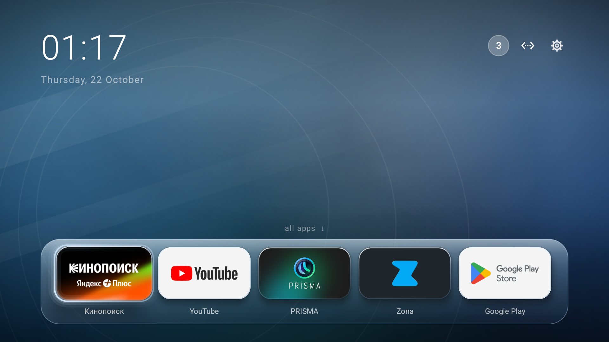
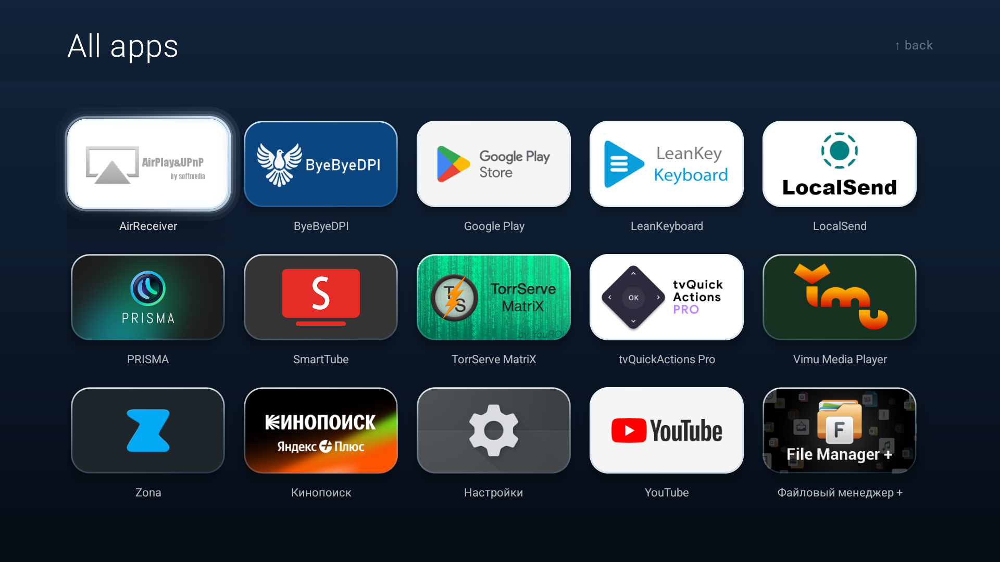
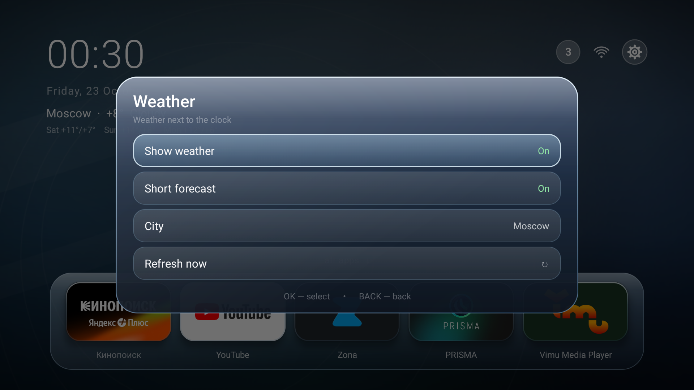
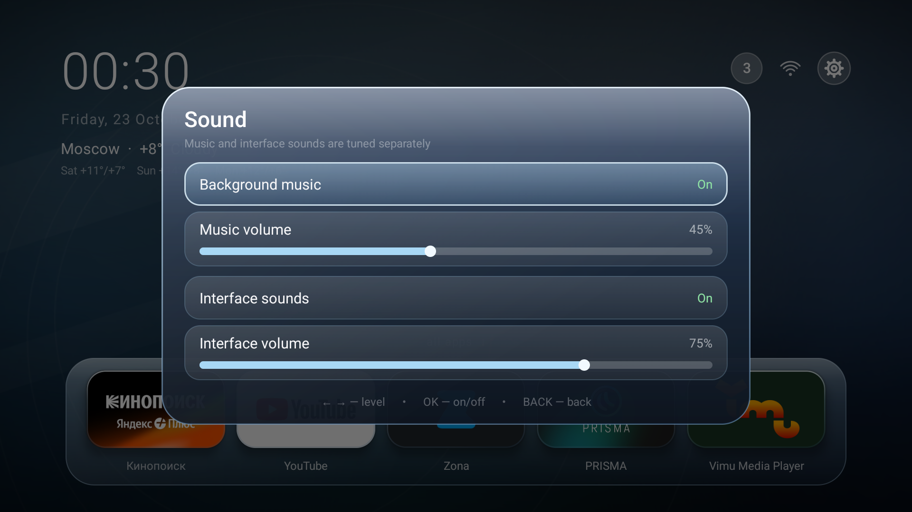
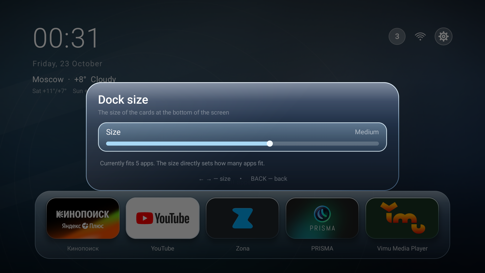
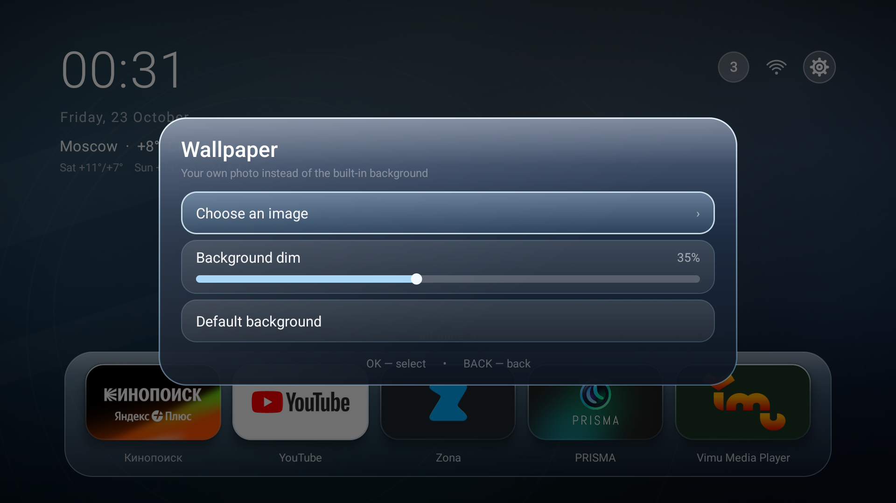
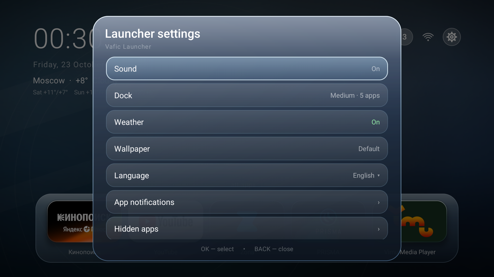
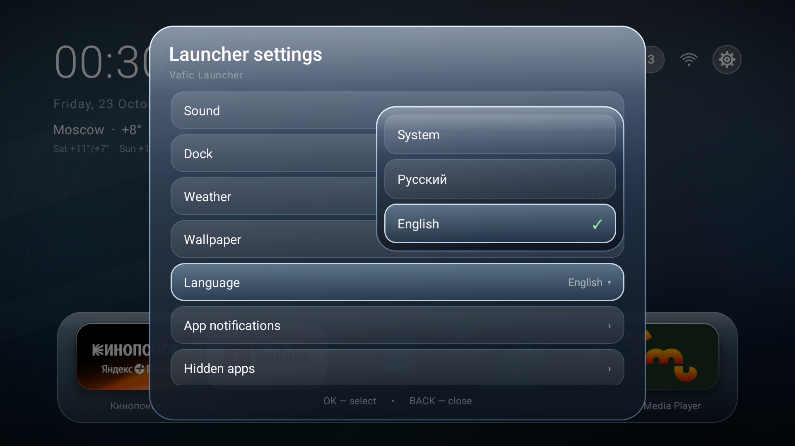
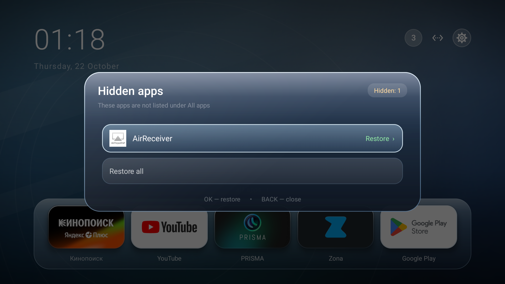
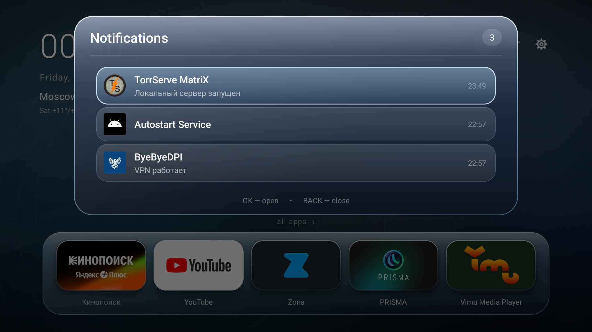

# Vafic Launcher

A quiet, controller-first home screen for Android TV. Three full rows, a fixed
header, a resizable dock of three to eight apps, optional weather and a short
forecast next to the clock, a live-updating library with hidden apps and
in-app deletion, a PS5-style focus outline and Windows-Aero glass surfaces —
built without AndroidX or Gradle. A small aapt2 resource step localizes the app
name to English and Russian.

[Русская версия](README.ru.md)

## Screenshots

| Home | All apps |
|---|---|
|  |  |

| Weather | Sound |
|---|---|
|  |  |

| Dock size | Wallpaper |
|---|---|
|  |  |

| Launcher settings | Language |
|---|---|
|  |  |

| Hidden apps | Notifications |
|---|---|
|  |  |

More screenshots, including the app menu and network panel, are in
[screenshots/en](screenshots/en). The Russian set is in
[screenshots/ru](screenshots/ru).

## Features

- **Home.** Clock and localized date, optional current weather with a short
  forecast, a dock of three to eight apps, and a fixed status cluster with
  notifications, network and **launcher settings**. Press Up from the dock to
  enter the status cluster; Down returns to the dock. The gear opens the
  launcher settings menu, which has a **System settings** entry for Android TV
  settings.
- **Weather.** Off by default. When enabled it shows the current temperature,
  condition and a short forecast next to the clock. The city is detected
  automatically or picked from a preset list / typed by hand, and the data can
  be refreshed on demand. The whole section can be switched off, and while it is
  off the launcher makes no weather requests.
- **Hidden apps.** Long-press an app and choose **Hide**: it leaves the library
  and the dock. The launcher settings keep a **Hidden apps** list where every
  hidden app can be restored, or all of them at once.
- **Delete an app.** The same long-press menu has **Delete**, which opens the
  television's system uninstall confirmation. After the package is removed, the
  app disappears from the dock and the library and its saved position, hidden
  state and notification filter entry are dropped.
- **Live library.** Installs, updates and uninstalls are picked up while the
  launcher is open, without leaving the screen or restarting it. If a package
  changes while another app is in front, the launcher refreshes when it becomes
  visible again. Removed apps also leave the dock, the hidden-apps list and the
  notification filter.
- **Focus-centred library.** Five columns, three full rows, labels always
  visible. Moving past the middle row glides the page by exactly one row.
  During the glide the focus outline rides the selected card, then continues to
  follow it normally after the page settles.
- **Reorderable library.** Long-press OK on an app and choose **Move**, then use
  the D-pad to place it; OK or BACK finishes. The order is remembered and new
  apps stay alphabetical at the end.
- **PS5-style focus.** A thin border hugs the card with a soft pearl-white
  gradient travelling around it. The outline is drawn above the glass layers.
- **Dock editing.** Long-press OK on a dock card to move, remove, hide or delete
  it. Long-press OK in the library to add/remove an app from the dock, move it
  in the library, hide it or delete it. The dock holds three to eight apps; the
  **Dock** settings scale the cards, directly set how many apps fit and can hide
  the app names under them. Without names the cards grow taller, so their
  artwork fills the freed space; names are shown by default.
- **First run.** The dock starts with a single **+** card. Press it (or Down) to
  open the library, then long-press an app and choose **Add to dock**. If the
  last app is removed, the **+** card returns.
- **Fresh library visits.** HOME forgets the library cursor, so the next
  **All apps** page starts at the first app. BACK keeps the selected app and
  returns to it.
- **Notifications.** Active notifications, a badge, clearable-only cleanup, and
  an optional per-app filter. System/no-clear notifications are kept. New or
  changed notification content can appear in a temporary glass banner that
  slides down from the top, queues multiple alerts and leaves D-pad focus
  untouched. Notifications waiting when access is granted are not replayed;
  foreground-service updates and apps muted in the notification filter do not
  pop up.
- **Aero-glass surfaces.** Cards, the dock and every panel are built from the
  same Windows-Aero material: cool blue translucent glass, a milky gloss along
  the top edge, a diagonal reflection, a bright blue rim and a soft shadow that
  lifts the card off the wallpaper.
- **Separate sound controls.** A rising glass note opens menus, the library and
  apps; a falling note goes back and closes panels. Focus ticks are played on
  every selectable element: the dock tiles, the top status cluster and the rows
  of the menus. Background music and interface sounds each have their own
  switch and volume slider. The music keeps its level while an interface sound
  plays, and the framework's duplicate focus/click effects are suppressed, so
  only the launcher's own sound is heard.
- **Wallpaper.** Pick a personal photo or keep the built-in Aero background.
  The **Background dim** slider applies the same darkening to both.
- **Language selection.** System, Russian or English, chosen from an anchored
  dropdown. All launcher-owned strings switch immediately; changing the language
  recreates the activity cleanly. The system app name is localized too:
  **Vafic Launcher** / **Vafic Лаунчер**.
- **Small and dependency-free.** Plain Java, no AndroidX, no analytics, no
  diagnostic logging. Network access is used only by the optional weather
  section, and only while it is enabled.

## Controls

| Button | Action |
|---|---|
| ← → ↑ ↓ | Move focus; in the library, move through the grid |
| ← → on a slider | Change a volume, the wallpaper dim or the dock size |
| ↑ from dock | Focus the status cluster (notifications / network / launcher settings) |
| OK | Open an app / panel / menu item; finish a move |
| Long OK | App menu: add/remove dock, move in the library, hide or delete the app, or move a dock card |
| BACK | Close a panel/menu, leave the library, or cancel a move |
| HOME | Return to the home screen and focus the first dock card |


The last command is optional: without notification access the launcher still
works, but the notification badge and shade stay empty. You can also grant access
in **Settings → Apps → Special app access → Notification access**.

Set Vafic Launcher as the home app in the TV settings if another launcher is
currently selected. The APK targets Android 14 (API 34) and supports API 23+.

## Settings

Open the gear in the top status cluster (press Up from the dock and walk to the
right). Launcher settings are not duplicated in the long-press menus.

- **Sound** — independent switches and volume levels for the background music
  and the interface sounds.
- **Dock** — card size from smallest (up to eight apps) to largest (three
  apps), limited to the largest size that still holds the current dock. Hide
  **App names** to remove the captions and let the cards grow taller.
- **Weather** — show or hide the whole section, show or hide the short
  forecast, choose the city, refresh now. Off by default; no network requests
  while off.
- **Wallpaper** — choose a photo, restore the built-in background, and set the
  background dim for either one.
- **Language** — System / Русский / English in an anchored dropdown.
- **App notifications** — per-app notification filter.
- **Hidden apps** — the apps that were hidden from the library; open one to
  bring it back, or restore all of them.
- **System settings** — open the Android TV settings.
- **Close** — leave settings.

The background track is a full lossless FLAC in `assets/ambient.flac`. It is
played as it is and loops seamlessly: the track fades out at the end and fades
in at the beginning, so the loop point is smooth and the sound is untouched.
The interface sounds are original synthesized WAV files in `assets/`:
`tick.wav`, `forward.wav` and `back.wav`.

## Build from source

Requirements:

- JDK 17+
- Android SDK platform 34
- Android SDK build-tools 34+
- Windows PowerShell (the build script is PowerShell; the source is portable)

Set the SDK and JDK locations, then run:

```powershell
$env:JAVA_HOME = "C:\path\to\jdk-17"
$env:ANDROID_SDK_ROOT = "C:\path\to\Android\Sdk"
powershell -NoProfile -ExecutionPolicy Bypass -File .\build.ps1
```

The script uses `aapt2`, `javac`, `d8`, `zipalign` and `apksigner` directly.
It writes `vafic-launcher.apk` next to the script.

Signing:

- By default a local debug keystore is created at `.keystore/vafic.keystore`
  (ignored by git). This is fine for sideloading and personal builds. Keep this
  file if you want future builds to install as an update over the current APK.
- For a release, provide your own key:

```powershell
$env:VAFIC_KEYSTORE = "C:\keys\release.keystore"
$env:VAFIC_KEYSTORE_PASS = "your-password"
```

Assets and resources are staged in the system temp directory because `aapt2` on
Windows cannot open an asset or resource directory whose path contains Cyrillic
characters. The script compiles `res/` into a temporary resource zip before
linking.

## Permissions

| Permission | Why |
|---|---|
| `QUERY_ALL_PACKAGES` | List every installed app in the library and notification filter |
| `REQUEST_DELETE_PACKAGES` | Open the system uninstall screen from the app menu |
| `INTERNET` | Optional weather only; no requests while weather is off |
| `ACCESS_NETWORK_STATE` | Show Wi-Fi/Ethernet/offline state |
| `ACCESS_WIFI_STATE` | Read Wi-Fi signal level and SSID |
| `BIND_NOTIFICATION_LISTENER_SERVICE` | Optional notification shade and heads-up banners |

The app accesses the network only for the optional weather section. **Delete**
does not uninstall anything by itself: it asks the system to show its normal
uninstall confirmation, and the package is removed only after the user confirms
there. No other package is changed silently. Any system debloating is a separate
device-level operation; it is not performed by the launcher. Uninstalling the
launcher and selecting another home app is enough to revert the launcher itself.

## Project layout

```
vafic-launcher/
  AndroidManifest.xml
  build.ps1
  assets/                 background track and interface sounds
  res/values/             English app name
  res/values-ru/          Russian app name
  src/com/vafic/launcher/ plain-Java sources
  screenshots/             pictures for the README and the release
  README.md
  README.ru.md
  RELEASE_NOTES.md
  LICENSE
  CHANGELOG.md
```

## Notes

- The launcher does not bypass paid content, remove ads from other apps, or
  include content from third-party services.
- App names and notification text come from the installed apps and are shown
  as provided by those apps.
- The project is not affiliated with Google, Sony or any TV vendor.

## License

MIT. See [LICENSE](LICENSE).
