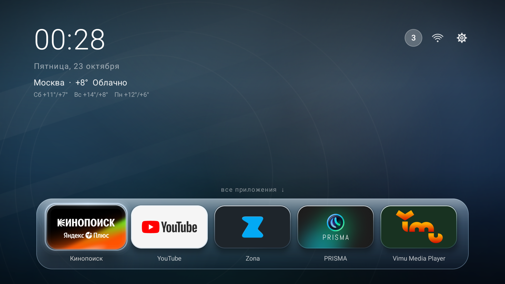
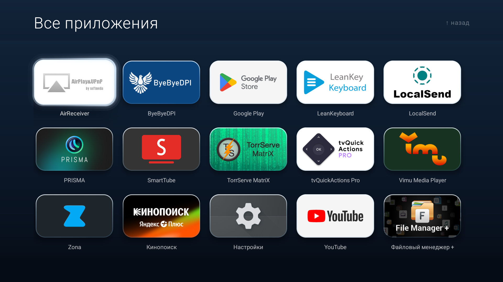
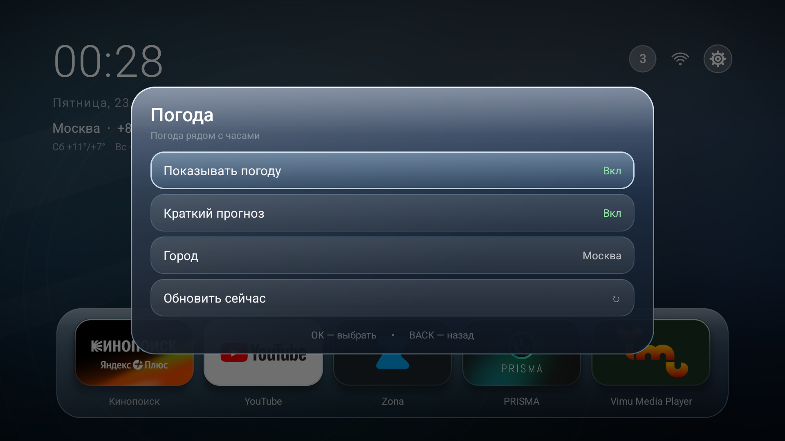
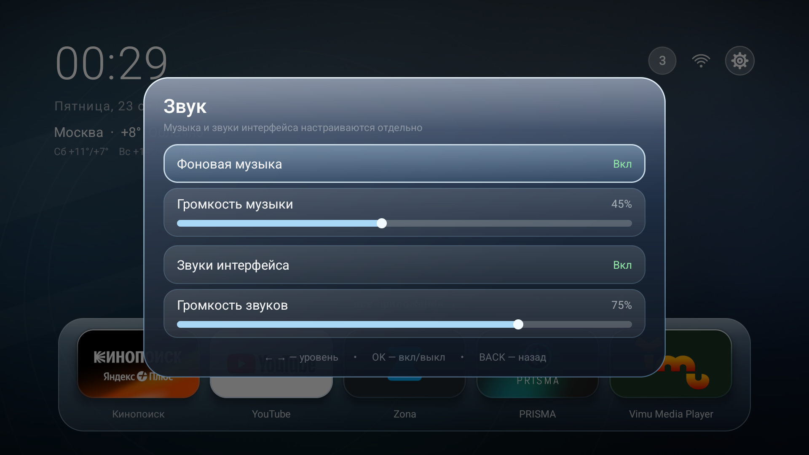
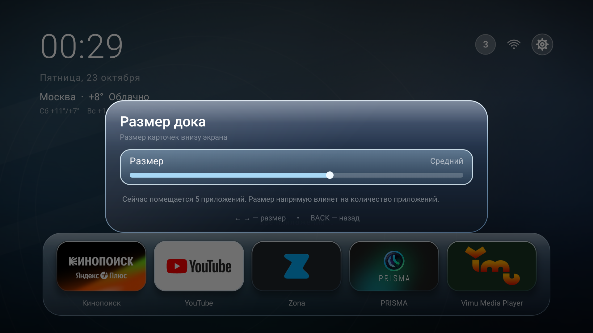
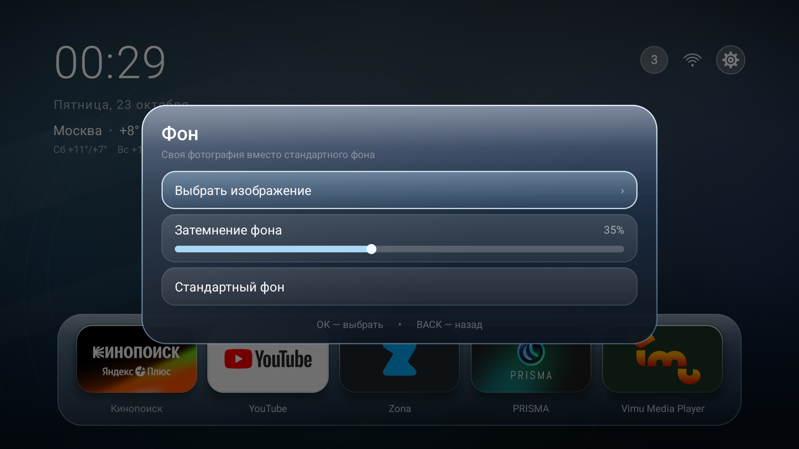
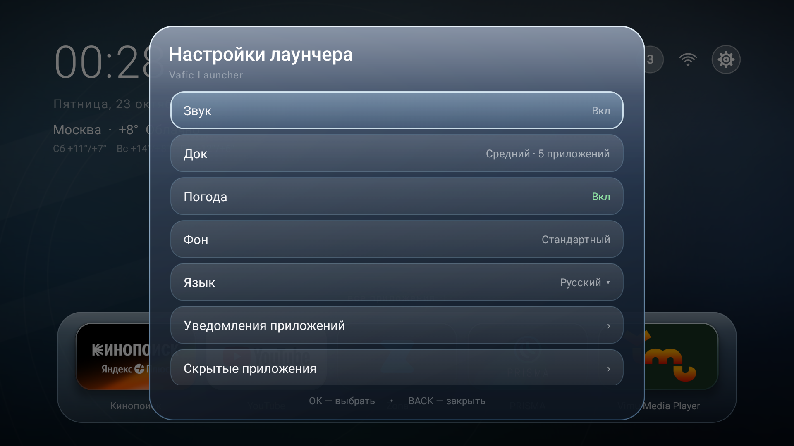
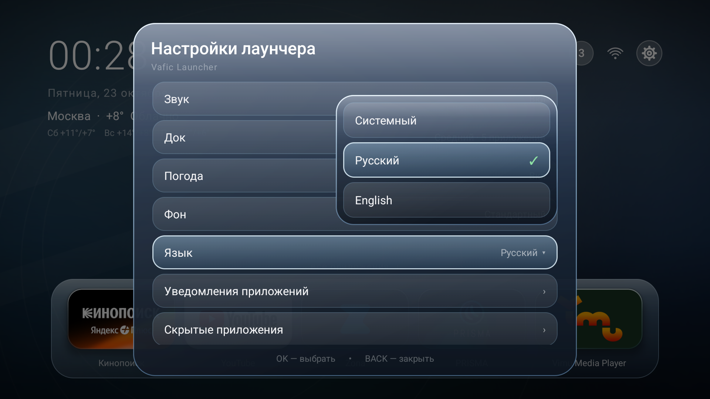
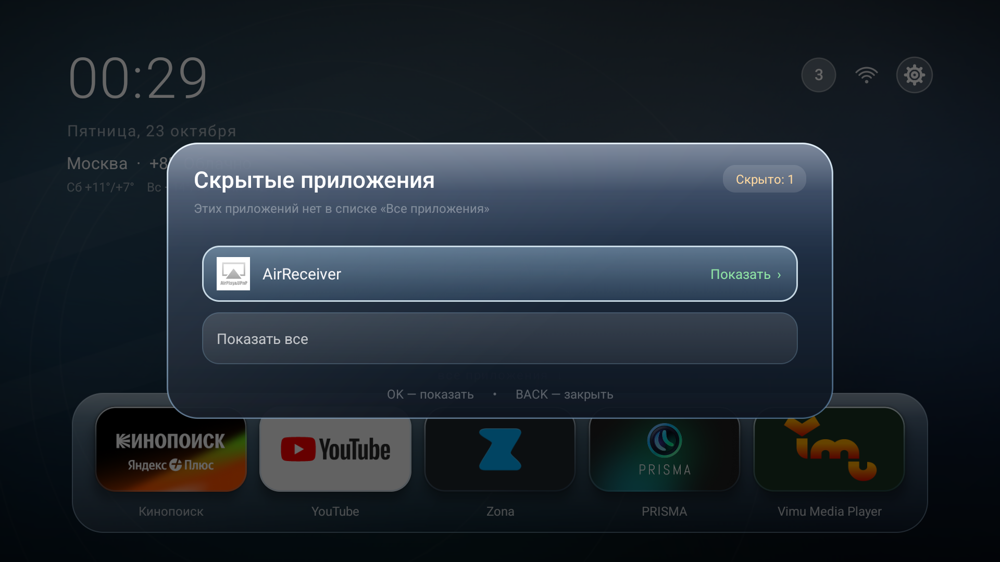
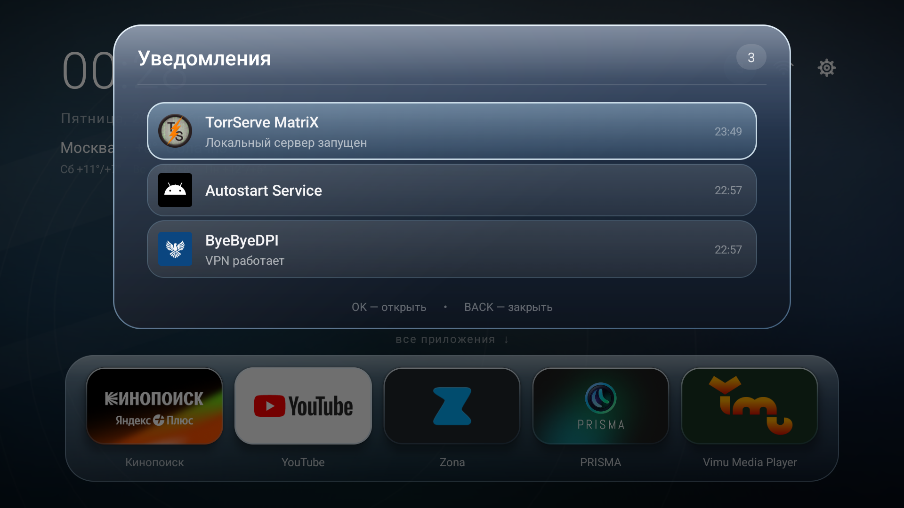

# Vafic Лаунчер

Тихий лаунчер для Android TV с управлением с пульта: три полных ряда, закреплённая
шапка, док на три–восемь приложений с регулируемым размером карточек,
необязательная погода и короткий прогноз рядом с часами, переставляемая
библиотека со скрытыми приложениями, обводка фокуса в духе PS5 и стеклянные
поверхности в стиле Windows Aero. Без AndroidX и Gradle; небольшой ресурсный шаг
aapt2 локализует название приложения на английский и русский.

[English version](README.md)

## Скриншоты

| Главный экран | Все приложения |
|---|---|
|  |  |

| Погода | Звук |
|---|---|
|  |  |

| Размер дока | Фон |
|---|---|
|  |  |

| Настройки лаунчера | Язык |
|---|---|
|  |  |

| Скрытые приложения | Уведомления |
|---|---|
|  |  |

Остальные снимки — меню приложения, сеть и прокрутка библиотеки — в
[screenshots/ru](screenshots/ru). Английский набор — в
[screenshots/en](screenshots/en).

## Возможности

- **Главный экран.** Часы и локализованная дата, необязательная текущая погода
  с коротким прогнозом, док на три–восемь приложений и закреплённая статусная
  строка с уведомлениями, сетью и **настройками лаунчера**. Нажатие Up из дока
  переводит фокус в статусную строку, Down возвращает в док. Шестерёнка
  открывает меню настроек лаунчера, где есть пункт **Системные настройки** с
  переходом в настройки Android TV.
- **Погода.** По умолчанию выключена. Во включённом виде показывает рядом с
  часами текущую температуру, состояние и короткий прогноз. Город определяется
  автоматически, выбирается из списка или вводится вручную; данные можно
  обновить по запросу. Погоду можно полностью выключить — пока она выключена,
  лаунчер не делает сетевых запросов.
- **Скрытые приложения.** Удерживайте OK на приложении и выберите **Скрыть** —
  приложение исчезнет из библиотеки и из дока. В настройках лаунчера есть
  список **Скрытые приложения**, оттуда их можно вернуть по одному или все
  сразу.
- **Библиотека с фокусом в центре.** Пять колонок, три полных ряда с подписями.
  При переходе ниже среднего ряда страница сдвигается ровно на одну строку.
  Во время сдвига обводка едет вместе с выбранной карточкой, а после остановки
  продолжает мягко следовать за фокусом.
- **Перестановка библиотеки.** Удерживайте OK на приложении, выберите
  **Переместить** и расставьте его стрелками; OK или BACK завершает режим.
  Порядок сохраняется, а новые приложения остаются в конце по алфавиту.
- **Обводка PS5.** Тонкая рамка вплотную к карточке и мягкий жемчужный градиент,
  бегущий по контуру. Рисуется поверх стекла и карточек.
- **Редактирование дока.** Долгое OK на карточке дока — переместить, убрать или
  скрыть. Долгое OK в библиотеке — добавить/убрать приложение в доке,
  переместить его в библиотеке или скрыть. В доке от трёх до восьми приложений;
  настройка **Размер дока** масштабирует карточки и напрямую задаёт ёмкость.
- **Первый запуск.** В доке сразу одна карточка **+**. Нажмите её (или Down),
  чтобы открыть библиотеку, затем удерживайте OK на приложении и выберите
  **Добавить на док**. Если убрать последнее приложение, карточка **+** вернётся.
- **Свежий запуск библиотеки.** HOME забывает позицию курсора, поэтому в
  следующий раз **Все приложения** открываются с первого приложения. BACK
  возвращает выбранное приложение.
- **Уведомления.** Список активных уведомлений, счётчик, очистка только
  разрешённых системой уведомлений (ongoing и `FLAG_NO_CLEAR` не трогаются),
  фильтр по приложениям.
- **Поверхности из стекла Aero.** Карточки, док и все панели собраны из
  одного материала в духе Windows Aero: прохладное синее полупрозрачное
  стекло, молочный глянец по верхнему краю, диагональный блик, яркий синий
  кант и мягкая тень, которая приподнимает карточку над обоями.
- **Раздельные настройки звука.** Восходящая стеклянная нота открывает меню,
  библиотеку и приложения; нисходящая — закрывает панели и возвращает назад.
  Тик фокуса звучит на любом выбираемом элементе: на карточках дока, в верхней
  статусной строке и на пунктах меню. У фоновой музыки и звуков интерфейса свои
  выключатели и ползунки громкости. Музыка не притихает во время звука
  интерфейса, а системные дубли тика и клика подавлены — слышен только звук
  лаунчера.
- **Обои.** Своя фотография или встроенный фон Aero. Ползунок **Затемнение фона**
  затемняет и фотографию, и стандартный фон.
- **Выбор языка.** Системный, русский или английский в выпадающем списке.
  Все строки лаунчера переключаются сразу; смена языка аккуратно пересоздаёт
  activity. Название приложения в системе тоже локализовано:
  **Vafic Launcher** / **Vafic Лаунчер**.
- **Компактность.** Чистый Java, без AndroidX, без аналитики и диагностического
  логирования. Сеть используется только необязательной погодой и только пока
  она включена.

## Управление

| Кнопка | Действие |
|---|---|
| ← → ↑ ↓ | Перемещение фокуса; в библиотеке — по сетке |
| ← → на ползунке | Изменить громкость, затемнение фона или размер дока |
| ↑ из дока | Фокус в статусную строку (уведомления / сеть / настройки лаунчера) |
| OK | Открыть приложение / панель / пункт меню; завершить перемещение |
| Долгое OK | Меню приложения: док, перемещение в библиотеке, скрытие или карточки дока |
| BACK | Закрыть панель/меню, выйти из библиотеки или отменить перемещение |
| HOME | На главную, фокус на первую карточку дока |

## Установка

```powershell
adb install -r vafic-launcher.apk
adb shell cmd package set-home-activity com.vafic.launcher/.MainActivity
adb shell cmd notification allow_listener com.vafic.launcher/.NotifListener
```

Последняя команда необязательна: без доступа к уведомлениям лаунчер работает,
но счётчик и панель уведомлений будут пустыми. Доступ также включается в
**Настройки → Приложения → Специальный доступ → Доступ к уведомлениям**.

Если выбран другой лаунчер, назначьте Vafic Лаунчер домашним приложением в
настройках телевизора. APK рассчитан на Android 14 (API 34), минимальная версия —
API 23.

## Настройки

Откройте шестерёнку в верхней статусной строке (Up из дока, затем вправо).
В меню долгого нажатия настройки лаунчера больше не дублируются.

- **Звук** — отдельные выключатели и уровни для фоновой музыки и звуков
  интерфейса.
- **Док** — размер карточек от минимального (до восьми приложений) до
  максимального (три приложения); больше текущей ёмкости док не растёт.
- **Погода** — показать или скрыть весь виджет, включить или выключить короткий
  прогноз, выбрать город, обновить сейчас. По умолчанию выключена; пока
  выключена, сетевых запросов нет.
- **Фон** — выбрать фотографию, вернуть стандартный фон и настроить затемнение
  для любого из них.
- **Язык** — Системный / Русский / English в выпадающем списке.
- **Уведомления приложений** — фильтр по приложениям.
- **Скрытые приложения** — приложения, скрытые из библиотеки; по одному или
  все сразу можно вернуть обратно.
- **Системные настройки** — переход в настройки Android TV.
- **Закрыть** — выйти из настроек.

Фоновая дорожка — полный lossless FLAC в `assets/ambient.flac`. Она играется как
есть и зацикливается плавно: трек затихает в конце и нарастает в начале, поэтому
стык цикла не слышен, а звук остаётся нетронутым. Звуки интерфейса — оригинальные
синтезированные WAV-файлы в `assets/`: `tick.wav`, `forward.wav` и `back.wav`.

## Сборка

Нужны:

- JDK 17+
- Android SDK platform 34
- Android SDK build-tools 34+
- Windows PowerShell

```powershell
$env:JAVA_HOME = "C:\path\to\jdk-17"
$env:ANDROID_SDK_ROOT = "C:\path\to\Android\Sdk"
powershell -NoProfile -ExecutionPolicy Bypass -File .\build.ps1
```

Скрипт напрямую использует `aapt2`, `javac`, `d8`, `zipalign` и `apksigner`.
Готовый файл `vafic-launcher.apk` появляется рядом со скриптом.

Подпись:

- По умолчанию создаётся локальный debug-keystore в `.keystore/vafic.keystore`
  (исключён из git). Этого достаточно для личной сборки и sideload. Сохраните
  файл, если хотите, чтобы следующие сборки ставились обновлением поверх текущей.
- Для релиза укажите свой ключ:

```powershell
$env:VAFIC_KEYSTORE = "C:\keys\release.keystore"
$env:VAFIC_KEYSTORE_PASS = "your-password"
```

Ассеты и ресурсы временно копируются в системный temp: `aapt2` в Windows не
открывает каталог ассетов или ресурсов, если в пути есть кириллица. Скрипт
компилирует `res/` во временный zip ресурсов перед линковкой.

## Разрешения

| Разрешение | Зачем |
|---|---|
| `QUERY_ALL_PACKAGES` | Полный список приложений в библиотеке и фильтре уведомлений |
| `INTERNET` | Только необязательная погода; пока она выключена, запросов нет |
| `ACCESS_NETWORK_STATE` | Wi-Fi / Ethernet / offline |
| `ACCESS_WIFI_STATE` | Уровень сигнала и SSID |
| `BIND_NOTIFICATION_LISTENER_SERVICE` | Необязательная панель и счётчик уведомлений |

Сеть используется только необязательной погодой; другие пакеты лаунчер не меняет.
Отключение системных приложений — отдельная операция на устройстве, лаунчер её не
выполняет. Для отката самого лаунчера достаточно удалить его и выбрать другой
home-экран.

## Структура

```
vafic-launcher/
  AndroidManifest.xml
  build.ps1
  assets/                 фоновая дорожка и звуки интерфейса
  res/values/             английское название приложения
  res/values-ru/          русское название приложения
  src/com/vafic/launcher/ исходники на Java
  screenshots/             картинки для README и релиза
  README.md
  README.ru.md
  RELEASE_NOTES.md
  LICENSE
  CHANGELOG.md
```

## Важно

- Лаунчер не обходит платный доступ, не вырезает рекламу из чужих приложений и
  не включает сторонний контент.
- Названия приложений и текст уведомлений приходят от установленных приложений.
- Проект не связан с Google, Sony или производителями телевизоров.

## Лицензия

MIT. См. [LICENSE](LICENSE).
